# Branch

A canvas for talking to AI the way you actually think: in branches, not one endless scroll.

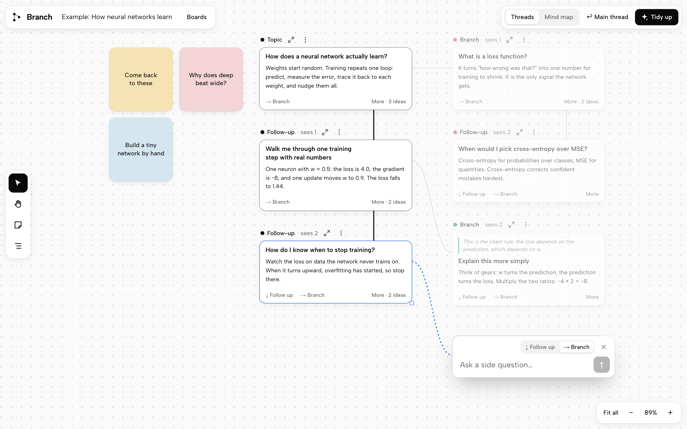

Chat apps put every question in one line, so a side question buries whatever you were doing and you end up scrolling to find it again. Branch lays the conversation out on a board instead. Side questions open off to the side, and the main thread stays where you left it.

## Why I built this

My neurodivergent brain thinks differently. It thinks in questions. One question opens three more, and I follow them: I test a hypothetical, wander down a side path, ask what would happen if. That's how I learn. But I also need to find my way back to the thread I started on, and a normal chat window loses it.

I also learn by connecting new ideas to my own life and stories. So when an adventure is over, I want to come back to what I found, with my own notes next to it, and revise from that.

Branch is the tool I wanted for all of that: somewhere to wander as far as I like, always find my way back, and leave with notes I actually wrote. If your brain works like this too, I hope it helps.

[Adhya Dagar](https://github.com/adhyadagar)

## What it does

**Wander**

- **Every question is a card.** A card shows the question and the opening of the answer, which the model writes to carry the takeaway. **More** expands the rest in place.
- **Follow up or branch.** A follow-up continues the thread. A branch opens a side question without disturbing it.
- **Branch on any passage.** Select some words in an answer to ask about just those words.
- **Branch ideas.** The model suggests up to 3 directions after an answer, and one click explores any of them.
- **The prompt bar goes where the answer will go.** Press Follow up or Branch and the bar moves into a dashed space below or beside the card, and the answer appears in that same spot. Reading a card never moves it.
- **Scoped context.** A card only sends the model the cards on its own path. Tangents stay out of the main thread, and each card shows how many earlier cards it sees.

**Find your way back**

- **See every thread.** The threads panel lists every thread on a board, with branches under the thread they came from.
- **Search a whole board.** Search questions, answers and your notes. A result takes you to its card with the match highlighted.
- **Open any path as a chat.** The arrows beside a card's label turn that path into a normal linear conversation, with chips to jump to its other branches.
- **Readable from far away.** Zoomed out, cards switch to large titles.

**Make it yours**

- **Highlight anything.** One click, like highlighting a textbook.
- **Write notes in your own words.** A note can stick to a passage or a card, or sit loose on the board. It's the same note wherever it lives.
- **Come back and revise.** Every highlight and note on a board collects in one list, in the order of the board.

**A real board**

- **Two layouts.** Switch between Threads (follow-ups go down, branches go right) and Mind map (a classic left-to-right tree). Each remembers where you put things.
- **Move things around.** Drag cards and whatever branches off them follows; hold Alt or Option to move just one card. Drag a corner to resize. **Tidy up** puts everything back in a clean layout, with an undo.
- **As many boards as you like.** Press **+** beside **Boards** to start a new one. A board names itself after your first question, and deleting one gives you a moment to undo it.
- **A guided first round.** The example board walks you through three things to try, then points you to a board of your own.

## How branching works

Every card gives you two ways to ask the next question. Both open the prompt bar right where the answer will appear, so you can see where it's going before you ask. You can switch between them in the bar at any point before sending.

### Follow up: keep going

A follow-up continues the same thread, so the bar opens directly below the card.

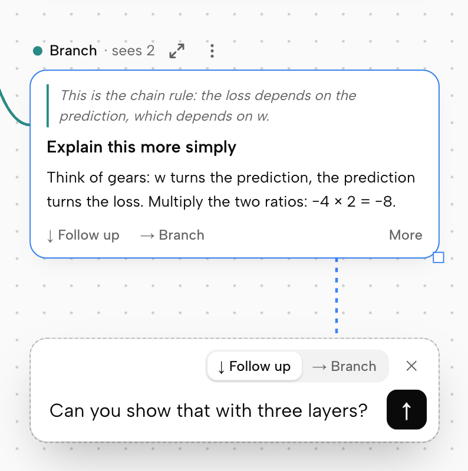

### Branch: ask a side question

A branch opens to the side, so the thread you were following stays exactly as it was. This is the same card and the same question as above, with Branch chosen instead.

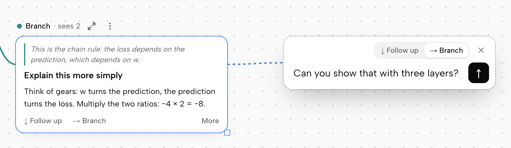

A thread only continues one way, so once a card has a follow-up, every other question from it becomes a branch.

### Branch on a single passage

Select any part of an answer and choose **Branch on this**.

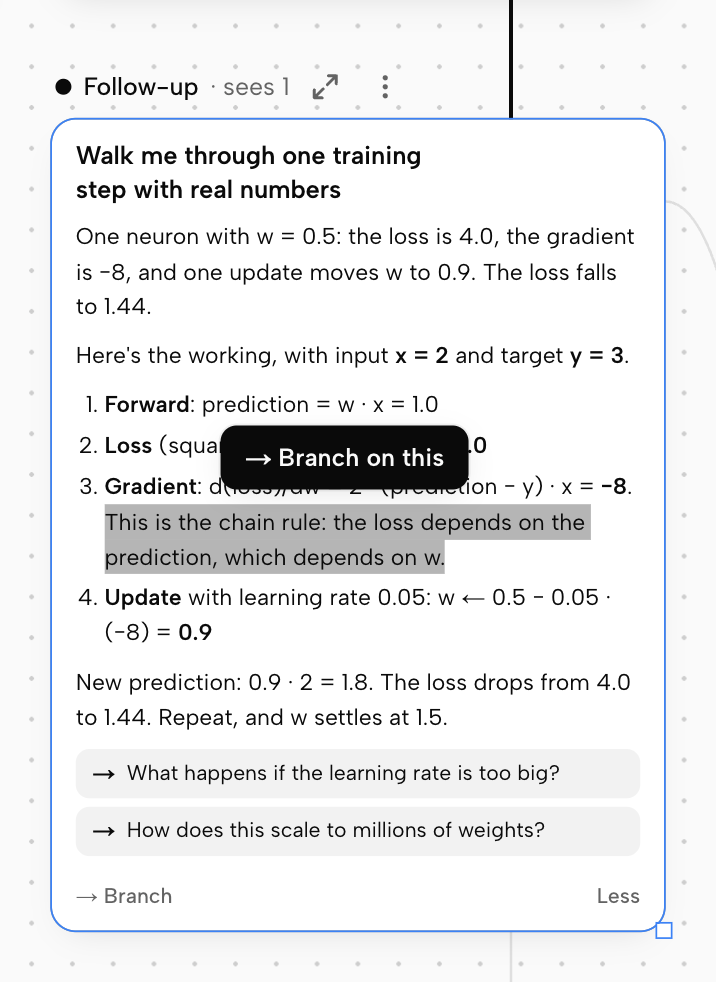

The new branch keeps that passage attached, and you can type a question or pick a ready-made one.

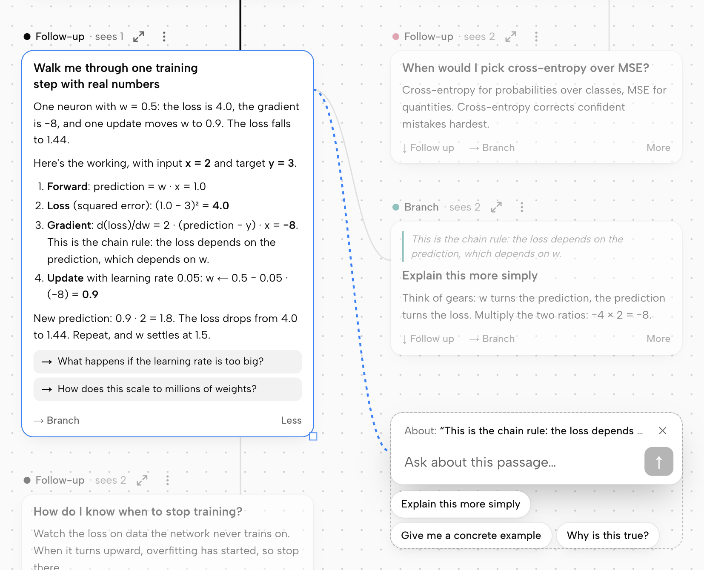

### Each branch keeps its own context

Click a card to see exactly what the model gets. Its path lights up and everything else fades.

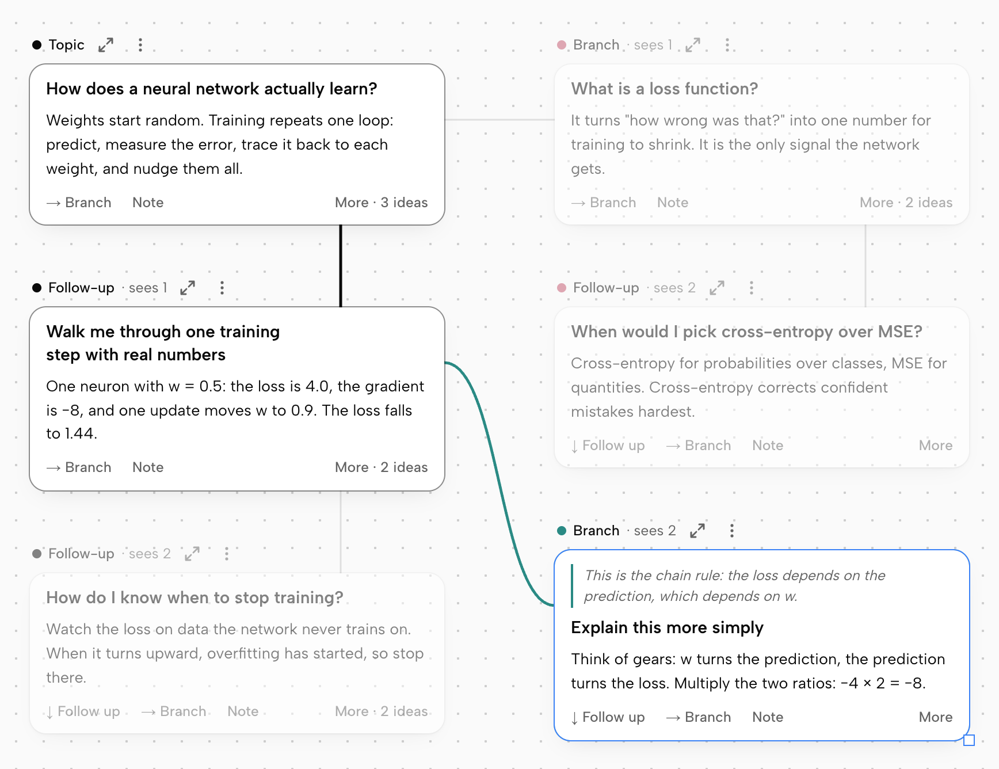

Here, the selected card sends the model its own question plus the 2 cards on its path, which is why its label says "sees 2". The faded cards aren't sent, so a tangent never leaks into another branch or the main thread.

### Switch to a mind map

The screenshots above use the Threads layout, where follow-ups go down and branches go right. **Mind map** shows the same conversation as a left-to-right tree, with every card beside the one it came from. It's a good way to see the whole shape of a topic. Each layout remembers where you've moved cards, so you can switch back and forth freely.

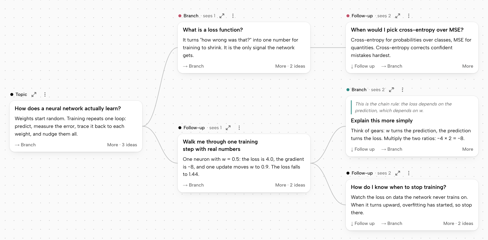

## Highlights and notes

Select some words in any answer, on a card or in the chat, and choose what to do with them.

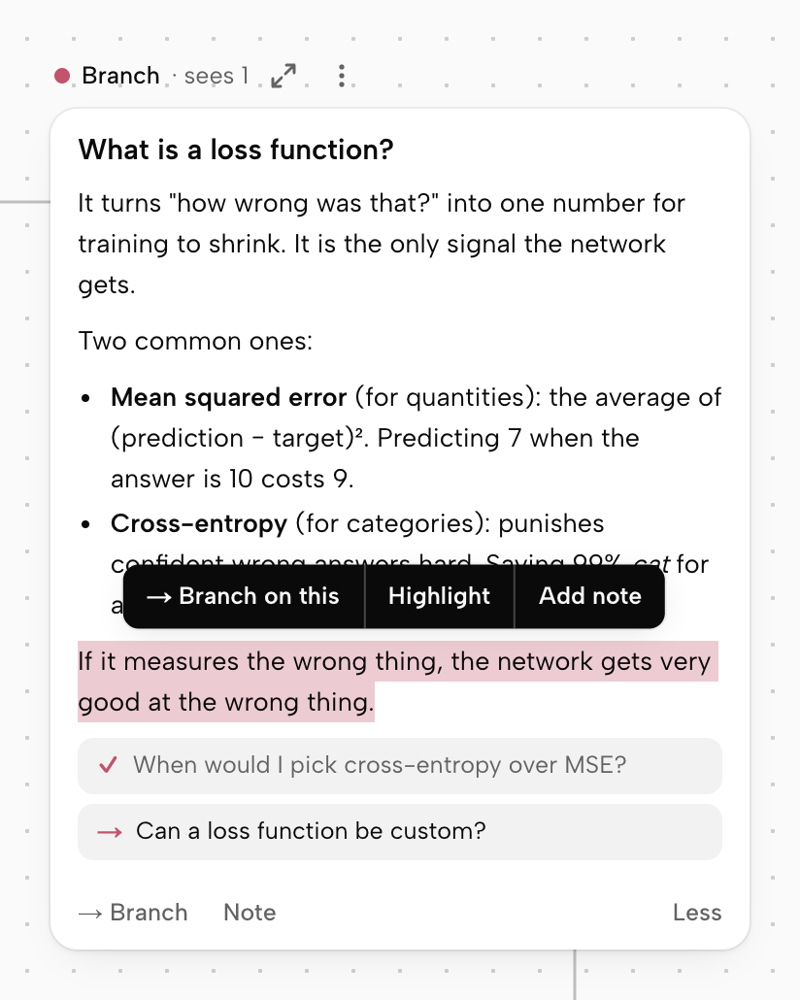

- **Highlight** marks the words straight away, with nothing to fill in.
- **Add note** opens a note beside the words, ready to type in. It saves as you type.

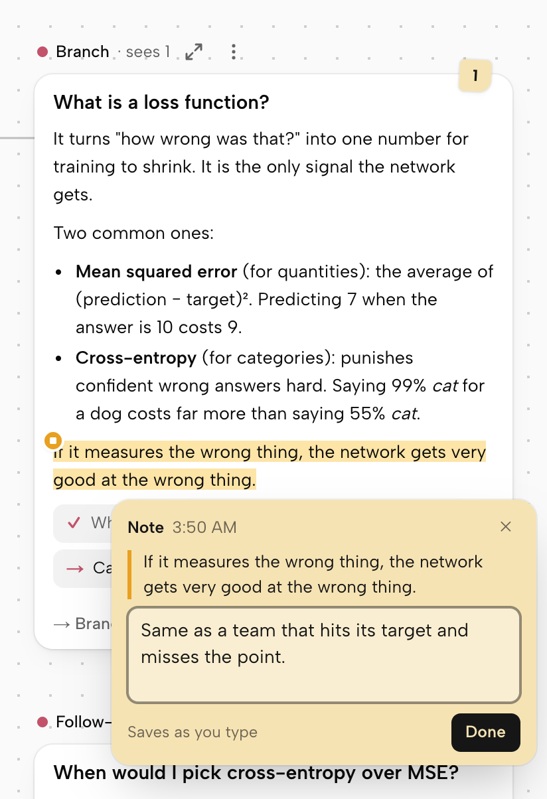

A note is one idea wherever it lives:

- **Stuck to a passage:** a small dot marks the highlight. Click the dot or the highlight to read or edit the note, or add a note to a highlight you made earlier.
- **Stuck to a card:** press **Note** on any card.
- **Loose on the board:** press <kbd>N</kbd> for a note you can drag anywhere, and turn into a new topic with **Ask →**.

A card with notes on it shows a small tab with how many there are, so you can see them at a glance and your cards stay readable.

### Come back and revise

The notes button on the left toolbar opens everything you've marked on the board, with the words around each highlight so you remember where it came from. Click one to go to it.

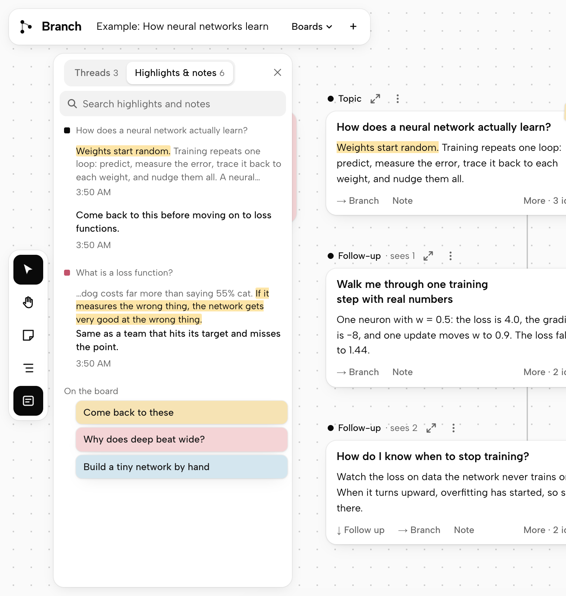

## Finding your way back

The threads button on the left toolbar, or <kbd>⌘</kbd>/<kbd>Ctrl</kbd> + <kbd>K</kbd>, lists every thread on the board. Click one to go to it and see its cards, or press the arrows to read it as a chat.

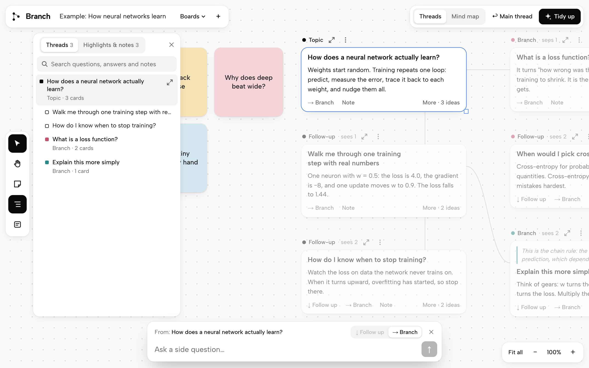

Search covers questions, answers and notes. A result opens its card and highlights the match, even if it's far down a long answer.

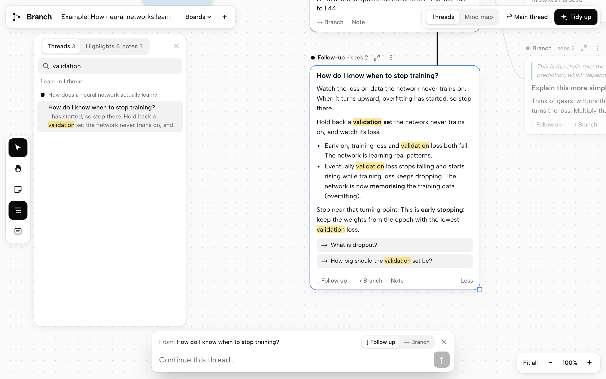

## Quick start

You need [Node.js](https://nodejs.org) 22 or later.

```bash
git clone https://github.com/adhyadagar/branch-ui.git
cd branch-ui
npm install
npm run dev
```

Open <http://localhost:3000>. You start on an example board with real answers already written, and a short guide walks you through three things to try. When you ask about a new topic, it starts a board of its own, so your work never begins inside the demo. Without an API key, new questions get placeholder answers.

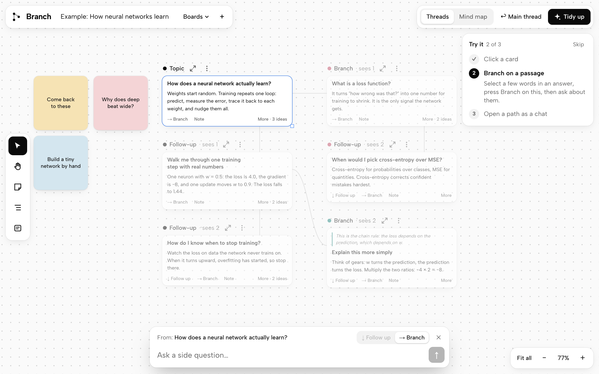

## Use a real model

**The quick way:** press **Add your key** at the top of the board and paste an [Anthropic API key](https://platform.claude.com/settings/keys). It's saved in your browser and sent only to Anthropic, which bills your account for what you use. Press **Your key** to replace or remove it.

**On your own machine,** you can keep the key in a settings file instead:

```bash
cp .env.example .env.local
```

Add one of these keys to `.env.local`, then restart `npm run dev`:

| Variable | Use it for | Default model (override with) |
| --- | --- | --- |
| `ANTHROPIC_API_KEY` | Calling Anthropic directly | `claude-sonnet-5-5` (`ANTHROPIC_MODEL`) |
| `AI_GATEWAY_API_KEY` | Any provider through [Vercel AI Gateway](https://vercel.com/docs/ai-gateway) | `anthropic/claude-sonnet-5.5` (`AI_GATEWAY_MODEL`) |

If both are set, `ANTHROPIC_API_KEY` is used. A key added in the browser takes priority over both.

## Security and privacy

- A key you add in the browser is saved in that browser and sent only to Anthropic. It never reaches Branch's server. Anyone who can use your browser profile could read it, so only add it on a computer you trust.
- A key in `.env.local` stays on the server, and that file is ignored by git.
- Boards are saved in your browser. What you ask is sent to the model provider, along with the earlier cards on that branch.
- Your highlights and notes stay in your browser and aren't sent to the model. A note on the board is only sent if you press **Ask →** on it.
- `/api/chat` has no login, so if you set a key on a server, **anyone who can reach it can spend your API credit**. `npm run dev` listens only on `localhost`, but `npm start` listens on all network interfaces. To host Branch publicly, leave the server keys unset, so visitors use their own, or put authentication in front of it.

See [SECURITY.md](SECURITY.md) for more, including how to report a vulnerability.

## Keyboard and mouse

| Do this | To |
| --- | --- |
| Drag the board, or scroll | Pan |
| <kbd>⌘</kbd>/<kbd>Ctrl</kbd> + scroll, or pinch on a trackpad | Zoom |
| Double-click a card | Open it as a chat |
| <kbd>V</kbd> / <kbd>H</kbd> | Select tool / pan tool |
| <kbd>N</kbd> | Add a note to the board |
| <kbd>⌘</kbd>/<kbd>Ctrl</kbd> + <kbd>K</kbd> | Search this board |
| <kbd>↑</kbd> / <kbd>↓</kbd>, then <kbd>Enter</kbd> | Move through the panel's list and open a row |
| <kbd>Esc</kbd> | Close a note or menu, cancel the question you were about to ask, leave the chat, or clear the search and close the panel |
| <kbd>Enter</kbd> / <kbd>Shift</kbd>+<kbd>Enter</kbd> | Send / new line |

## Where things live

| File | What it does |
| --- | --- |
| `src/lib/layout.ts` | Both layouts, and the curves between cards |
| `src/lib/view.ts` | Camera and card positions, kept outside React so panning stays smooth |
| `src/lib/actions.ts` | Everything the UI can do: asking, drag, tidy up, boards, notes |
| `src/lib/ask.ts` | Builds a card's context from its path and streams the answer into it |
| `src/lib/apiKey.ts` | A visitor's own key: saving it, checking it and calling Anthropic from the browser |
| `src/lib/prompt.ts` | The model's instructions and default model |
| `src/lib/answer.ts` | Splits model output into the opening a card shows, the full answer and branch ideas |
| `src/lib/annotations.ts` | Finds noted passages in an answer and paints their highlights and dots |
| `src/lib/search.ts` | Searches a board's threads and highlights matches on cards |
| `src/lib/store.ts` | Boards and UI state, saved to localStorage, plus migrations for older boards |
| `src/lib/sample.ts` | The example board |
| `src/app/api/chat/route.ts` | Model call (AI SDK `streamText`) and demo mode |
| `src/components/Canvas.tsx` | The board: pan, zoom, drag, resize and placing cards |
| `src/components/Card.tsx` | A card |
| `src/components/PromptBar.tsx` | The prompt bar and how it moves |
| `src/components/ChatView.tsx` | A path as a linear conversation |
| `src/components/ThreadsPanel.tsx` | The list of a board's threads, its highlights and notes, and the search over them |
| `src/components/Notes.tsx` | Writing and reading the notes on a card or passage |
| `src/components/Guide.tsx` | The guided first round on the example board |
| `src/components/KeyDialog.tsx` | Adding, replacing and removing your key |

## Contributing

Bug reports, ideas and pull requests are welcome. See [CONTRIBUTING.md](CONTRIBUTING.md).

## License

[MIT](LICENSE)
